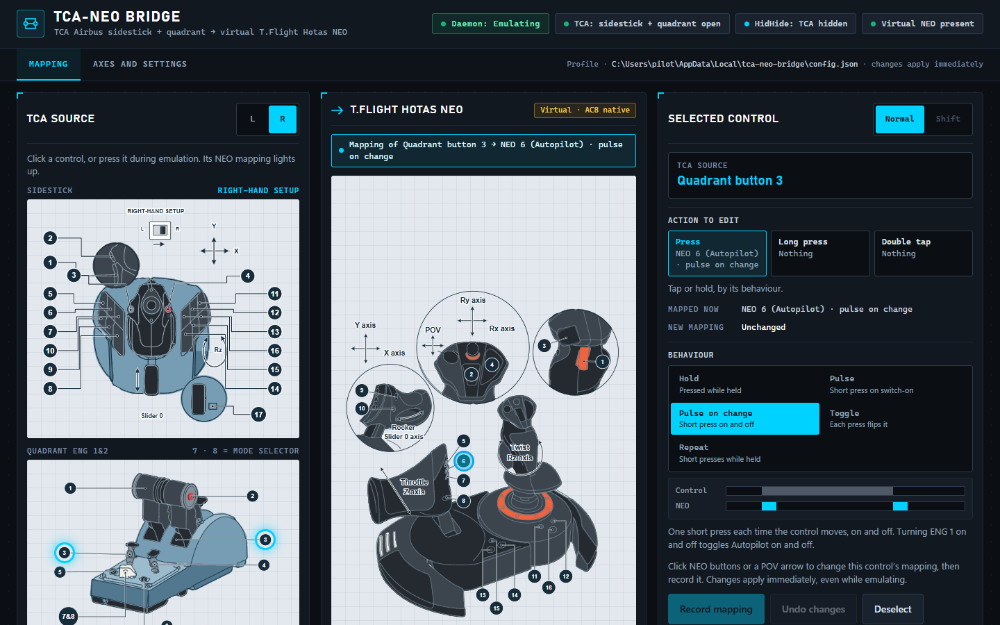
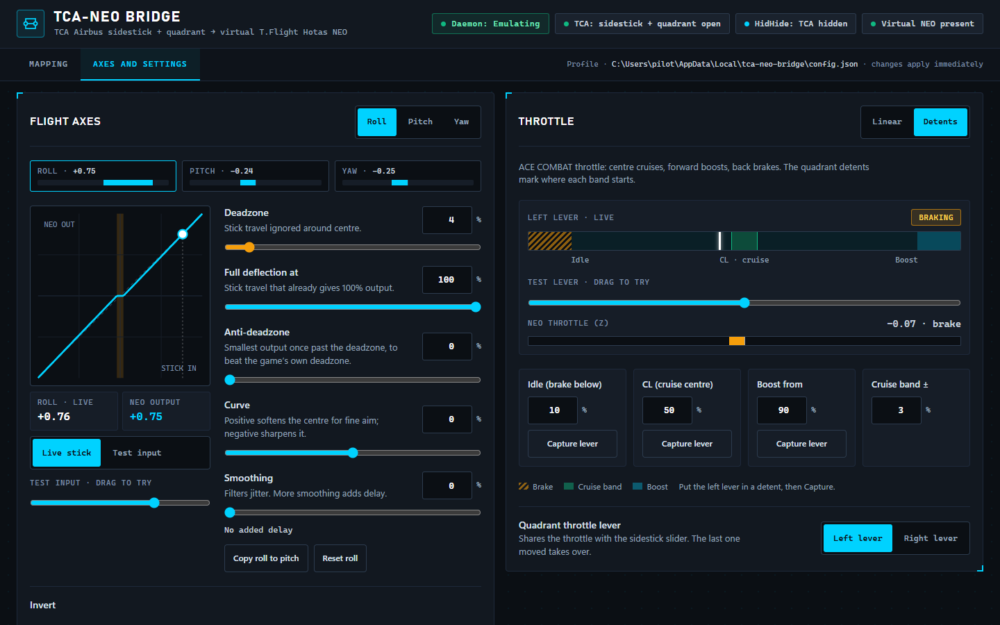
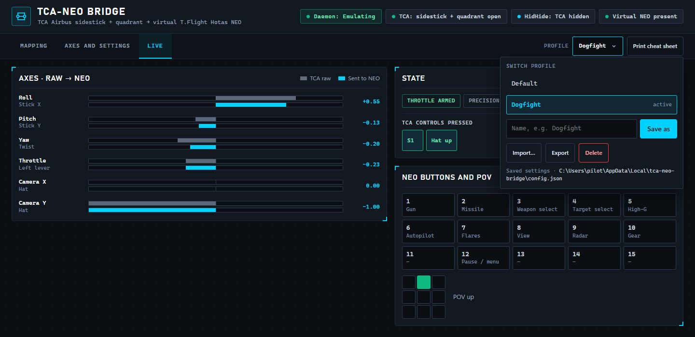

<p align="center">
  
</p>

# TCA-NEO bridge

Fly **ACE COMBAT 8** with a **Thrustmaster TCA Sidestick Airbus Edition** and **TCA Quadrant Eng 1&2**, using the game's **native HOTAS controls**.

ACE COMBAT 8 natively supports the Thrustmaster T.Flight Hotas NEO, but not the TCA Airbus Edition. TCA-NEO bridge is a small Windows tray application plus a user-mode driver. Together they present your TCA sidestick and quadrant to Windows as a virtual T.Flight Hotas NEO, so the game uses its NEO profile: separate throttle, camera mini-stick and native button actions. You choose which TCA control drives which NEO control on a visual mapping page.

> **Status (October 2026):** the virtual NEO is recognised and read correctly by the Thrustmaster SDK, including ten-minute runs and live TCA input. In-game verification with ACE COMBAT 8 is in progress; please report your results in Issues. See [docs/ENGINEERING.md](docs/ENGINEERING.md) for the test evidence and known issues.

Not affiliated with Thrustmaster/Guillemot, Bandai Namco or Microsoft. See [Trademarks](#licence-and-trademarks).

## Another Thrustmaster HOTAS?


This bridge supports only the TCA Airbus sidestick + quadrant. For a T.16000M (+ TWCS), HOTAS Warthog, T.Flight Hotas X / 4 / One, TCA Boeing or another Thrustmaster HOTAS, try the **Any-TM-HOTAS experimental bridge**.

- **It is untested.** The maintainer owns only the TCA Airbus pair, so players are the testers.
- **Download** the `any-tm-hotas-experimental-bridge-…` zip marked **Pre-release** from [Releases](https://github.com/mkainchi/tca-neo-bridge/releases). It installs beside this bridge and never changes this bridge's settings.
- **Read** the [guide for players](https://github.com/mkainchi/tca-neo-bridge/blob/release/any-tm-hotas-experimental-bridge/docs/EXPERIMENTAL-ANY-HOTAS.md) first.
- **Report** how it went with a [HOTAS test report](https://github.com/mkainchi/tca-neo-bridge/issues/new?template=hotas-test-report.yml), even if everything worked.
- **Improve it:** the source is on the [`release/any-tm-hotas-experimental-bridge`](https://github.com/mkainchi/tca-neo-bridge/tree/release/any-tm-hotas-experimental-bridge) branch; see [CONTRIBUTING.md](CONTRIBUTING.md).

## How it works

```text
TCA Sidestick + Quadrant ─► TCA-NEO bridge (tray app) ─► virtual NEO driver ─► ACE COMBAT 8
       (hidden from the game by HidHide)       your mapping          (user mode)
```

- The tray app reads the TCA devices, applies your mapping and streams NEO input reports to the driver.
- **HidHide** hides the physical TCA devices from the game while emulating, so the game sees only the NEO.
- The driver is a **user-mode** (UMDF) driver built from Microsoft's open-source sample. It is signed on your own PC at install time with a single-use certificate whose private key is deleted immediately; see [SECURITY.md](SECURITY.md).

## Prerequisites

- **Windows 11 x64**, build 22000 or later.
- **TCA Sidestick Airbus Edition** (Pilot or Copilot) and **TCA Quadrant Eng 1&2**, both connected by USB. No Thrustmaster software is needed.
- **[HidHide](https://github.com/nefarius/HidHide/releases)** by Nefarius, installed (reboot if its installer asks). Leave its application list free of Steam and keep "inverse application cloak" off.
- **Administrator rights.** Creating the virtual device and installing the driver require them.
- ACE COMBAT 8. If you play through Steam, **disable Steam Input** for the game so Steam doesn't remap the NEO.

## Installation

1. Download `tca-neo-bridge-<version>-x64.zip` from [Releases](https://github.com/mkainchi/tca-neo-bridge/releases). To check the download, run `Get-FileHash tca-neo-bridge-<version>-x64.zip` in PowerShell and compare the result with the `.sha256` file published next to it.
2. Extract it to a permanent folder, for example `C:\Tools\tca-neo-bridge`. Keep `neo-daemon.exe` and the `driver` folder together.
3. Right-click `neo-daemon.exe` → **Run as administrator**. Its cyan bridge icon appears in the notification area; the tooltip shows "TCA-NEO bridge" and the current status.
4. Right-click the icon → **Install driver…** and approve the Windows prompt. A window shows the steps, and a notification confirms "Driver installed". The log is in `%LOCALAPPDATA%\tca-neo-bridge\driver-install.log`.

## Usage

1. **Close Steam and the game.**
2. Right-click the tray icon → **Start emulation**. The tooltip shows *Emulating*.
3. Start Steam and ACE COMBAT 8. The game should list the controller as a T.Flight Hotas NEO and use its HOTAS controls.
4. When you're done, choose **Stop emulation**, or **Quit**. Both release every control, remove the virtual NEO and restore HidHide's previous settings.

### Tray menu

The icon's badge shows the emulation status: a gray hollow circle when idle, a green check when emulating, amber dots while starting or stopping, and a red exclamation mark on error. Hover over the icon for the full status or error message. While the driver installs, its menu item reads **Installing driver…**, and a notification reports the result.

| Item | What it does |
| --- | --- |
| Start emulation / Stop emulation | Hide the TCA devices and create the virtual NEO, or undo both. |
| Configure… | Opens the configuration page in your browser (local only). Double-clicking the icon does the same. |
| Pause input / Resume input | While emulating, releases every control and sends a neutral NEO until resumed. The tooltip shows *input paused*. A TCA button combo can do the same (see *Axes and settings*). |
| Profile ▸ | Appears once a profile is saved under a name. Choosing one makes it the active profile, even mid-flight; a balloon confirms it. The active one is checked. |
| Install driver… / Reinstall driver… | Installs the driver, or replaces it with a freshly signed copy. Available while not emulating. |
| Quit | Stops emulation and exits. |

### Mapping tab



The header shows the daemon status and, while emulating, whether the TCA is open, whether HidHide hides it and whether the virtual NEO exists. The left panel shows the TCA sidestick (switch **L / R** for a left- or right-hand setup) and quadrant, the middle one a T.Flight Hotas NEO with its numbered buttons and POV hat. Below them, a table lists NEO buttons 1–15 with their ACE COMBAT 8 actions and the TCA controls that feed each one.

- **Click a TCA control,** or press it while emulating. Its current NEO targets light up.
- **Click NEO buttons or POV arrows** to build its new mapping. Blue ring means kept, yellow ring means added, red dashed ring means removed. Then choose **Record mapping**. Changes apply immediately, even while emulating.
- **With nothing selected,** clicking a NEO control or a row of the NEO button table highlights every TCA control that feeds it.
- **Behaviour** sets how the selected control drives its NEO targets: **Hold** (pressed while held), **Pulse** (a short press when it switches on), **Pulse on change** (a short press each time it moves, on and off), **Toggle** (each press flips it) or **Repeat** (short presses again and again while held). A small timeline shows what the game receives. It is recorded with the mapping.
- **Action to edit** picks what the NEO clicks change: the **Press**, a **Long press** (held for the long-press time: its targets are held instead of the press) or a **Double tap** (two taps within the double-tap window). Each tile shows its current mapping. With a long press or double tap set, a tap is sent as a short press once the control is released and the double-tap window has passed.
- **Normal / Shift** switches the layer being mapped once a shift control is set (see *Axes and settings*). While the shift control is held, controls with a shift-layer mapping send it instead; the others keep their normal mapping.
- **Under *Other TCA inputs*,** set the **sidestick hat** to drive either the **Camera** (the NEO mini-stick, the default) or **Mapped controls**. In Mapped mode, its four directions can be mapped like buttons, and the camera gets no input.
- **Recorded corrections** keeps a log of every change you record.

### Axes and settings tab



| Setting | Meaning |
| --- | --- |
| Flight axes | Pick **Roll**, **Pitch** or **Yaw** and set its **deadzone** (travel ignored around centre), **full deflection at** (travel that already gives 100 %), **anti-deadzone** (the smallest output past the deadzone, to beat the game's own) and **curve** (positive softens the centre for fine aim, negative sharpens it). **Copy** applies them to the other axes. |
| Live preview | The curve graph redraws as you drag. A dot shows where the input lands and the readouts give stick in and NEO out. Use **Test input** to try settings without hardware, or **Live stick** while emulating. A strip shows all three axes at once. |
| Smoothing | Per axis, filters jitter; the delay it adds is shown in milliseconds. |
| Camera | **Strength** of the hat on the NEO mini-stick, and a **Ramp** time to reach it (0 is instant), with a graph of the camera output while the hat is held. **Full strength after a long press** lets a held hat look all the way round. **Hat + spare lever** lets the quadrant lever that is not the throttle pan the camera; the hat wins while pressed. |
| Yaw source | **Twist** (the default), **Off**, or **Lever difference**: pushing one quadrant lever ahead of the other yaws towards the back lever, and the throttle follows the average of both levers. |
| Timing | Long-press time, double-tap window, repeat interval and pulse length, in milliseconds. |
| Throttle | **Linear** maps lever travel straight to the NEO throttle. **Detents** follows ACE COMBAT: below **Idle** brakes fully, within **Cruise band** of **CL** cruises, from **Boost** boosts fully, with smooth ramps in between. While emulating, put the lever in each detent and choose **Capture lever**. The sidestick slider stays linear. |
| Quadrant throttle lever | Left or right lever. It shares the throttle with the sidestick slider; the last one moved takes over. |
| Invert | Per axis. |
| Precision aiming | While the chosen control is held, roll, pitch and yaw are scaled down (50 % by default) for fine aim. Choose **Press a control…**, then press it on the TCA. |
| Safe start | On by default. When emulation starts or input returns after a dropout, the throttle stays at centre until the active lever or slider reaches centre or moves across it. A lever left fully forward or at idle never launches you at full power or full brake. |
| Shift layer | While the chosen control is held, other controls use their Shift-layer mappings. Its own mapping is not sent while it is the shift control. |
| Pause input | Up to four controls pressed together pause and resume input, like the tray item. Choose **Record combo…**, press them, then **Done**. |
| Shared levers | Split-lever High-G, the camera lever and lever-difference yaw each use the quadrant levers, so only one can be on: turning one on turns the others off and says so. |
| High-G from split levers | Thresholds are lever travel: 0 % at idle, 100 % fully forward. While one quadrant lever is at or above the *forward* threshold and the other at or below the *back* threshold, NEO 5 (High-G) is held. The throttle follows the forward lever, with the same response. While emulating, live bars show both lever positions against the saved thresholds. |
| Try in game | Runs your unsaved settings in the running emulation without saving them; an amber *Previewing unsaved settings* pill shows while it's on. **Save settings** keeps them; **Discard changes**, leaving the tab or stopping emulation goes back to the saved profile. |

Profiles saved by version 0.2.x are upgraded when loaded: their single deadzone becomes each axis's deadzone, and every control keeps holding its NEO button as before.

### Head tracking

Under *Axes and settings*, **Head tracking** lets you look around with your head through [OpenTrack](https://github.com/opentrack/opentrack) (TrackIR, a webcam or a phone). In OpenTrack, set the output to **UDP over network**, remote IP `127.0.0.1` and the port shown (4242 by default), and start tracking. The bridge listens on this computer only. Head yaw and pitch move the NEO camera through their own deadzone and curve, with full deflection at the look ranges you set; invert either if it moves the wrong way. The hat still works and wins while pressed, and without OpenTrack data for the fall-back time the camera returns to the hat. The status line shows whether data arrives. The port and turning it on or off take effect when emulation starts.

### If the TCA disconnects

The virtual NEO stays, so the game keeps its controller. Every control is released at once, a tray balloon says so, the header pill shows **TCA: reconnecting…**, and the bridge looks for the TCA every second. When it returns, even on another USB port, it is hidden from the game again and a balloon confirms it; with safe start on, move the throttle to centre once. Emulation stops only if the returning TCA cannot be hidden again.

### Launch warnings

When emulation starts, the bridge checks the launch order and warns, without changing anything, if Steam was already running or Steam Input is on for ACE COMBAT 8. The warnings appear as tray balloons and as a banner on the configuration page.

### Live tab



While emulating, the **Live** tab shows every axis as the raw TCA input above what the NEO receives, so you can see the effect of your curves, detents and camera settings in flight. It also shows the bridge state (throttle armed or waiting for safe start, precision, shift, paused, preview), the TCA controls being pressed, the 15 NEO buttons lit as they are sent, and the POV.

### Profiles and cheat sheet

The **Profile** menu in the tab bar lists your saved profiles. Choose one to switch to it; the current settings must be saved or discarded first.

- **Save as** stores the saved settings under a name (letters, digits, spaces, `_` and `-`) and makes it the active profile.
- **Import…** loads a profile JSON file someone shared. The bridge checks it, and upgrades older ones, before it becomes your settings; save it under a name to keep it.
- **Export** downloads the saved settings as a JSON file.
- **Delete** removes the active profile after a second click. The settings themselves stay.
- A **Next profile** combo under *Control helpers* cycles through the saved profiles in name order while flying, and the tray has a **Profile** submenu.

**Print cheat sheet** prints a light A4 page from the saved profile: every mapped control with its press, long press, double tap and shift-layer action, the axes, the helpers and the timings.

### Default mapping

| TCA | NEO | ACE COMBAT 8 action |
| --- | --- | --- |
| Sidestick buttons 1–15 | NEO buttons 1–15 (same numbers) | 1 Gun · 2 Missile · 3 Weapon select · 4 Target select · 5 High-G · 6 Autopilot · 7 Flares · 8 View · 9 Radar · 10 Gear · 12 Pause/menu |
| Quadrant lever buttons 1, 2 | 5 | High-G |
| Quadrant ENG 1/2 switches (3, 4) and button 6 | 6 | Autopilot |
| Quadrant button 5 | 9 | Radar |
| Quadrant mode selector (7, 8) | 7, 8 | Flares, View |
| Sidestick stick, twist | X/Y, Rz | Roll/pitch, yaw |
| Left quadrant lever or sidestick slider | Z | Throttle |
| Sidestick hat | Rx/Ry mini-stick | Camera |
| Levers split (one ≥ 75 %, other ≤ 25 %) | 5 | High-G |

The ENG switches and the mode selector stay in position, so they don't hold their NEO buttons. The ENG switches **pulse on change**: turning one on, and off again, each sends one short Autopilot press. The mode selector **pulses** once when it moves into position 7 or 8, giving one burst of flares rather than a stream. Change this with **Behaviour** on the Mapping tab. **Reset everything to defaults** on the settings tab restores this table, with safe start on and a linear throttle.

## Files and data

Everything is kept per user in `%LOCALAPPDATA%\tca-neo-bridge`:

- `config.json`: your profile.
- `label-map.json`: the recorded corrections.
- `neo-daemon.log`: status changes and errors (never device paths or serial numbers).
- `driver-install.log`.
- `hidhide-session.json`: only while emulating; used to restore HidHide after an interruption.
- `profiles\`: named profiles (`<name>.json`) and `active.txt`, the name of the active one.

Run `neo-daemon.exe --data <folder>` to use another folder.

## Troubleshooting

| Symptom | What to do |
| --- | --- |
| "The virtual NEO could not start / did not appear" | Use **Install driver…** (or **Reinstall driver…**) and make sure the app runs as administrator. |
| "Creating the virtual NEO requires administrator rights" | Restart `neo-daemon.exe` with **Run as administrator**. |
| HidHide errors | Install HidHide, close its configuration client, remove Steam from its application list, turn *inverse application cloak* off, reconnect both TCA devices. |
| "Connect exactly one supported TCA sidestick and one Quadrant" | Plug in both devices, and only one of each. Using another Thrustmaster HOTAS? See [Another Thrustmaster HOTAS?](#another-thrustmaster-hotas) |
| A control is "stuck" | A quadrant switch set to **Hold** is resting in an active position. Set its **Behaviour** to **Pulse on change** on the Mapping tab; see *Default mapping*. |
| The throttle does nothing after starting | Safe start is waiting: move the throttle lever (or the sidestick slider) to centre once. |
| The aircraft is too twitchy or too sluggish | Tune that axis's curve and deadzone on *Axes and settings*. Try them with **Try in game**, then save. |
| The game sees the TCA devices as well | Start emulation **before** starting Steam and the game. The page warns when Steam was already running. |
| "Steam Input is on for ACE COMBAT 8" | In Steam, open the game's **Properties › Controller** and choose **Disable Steam Input**. |
| "Head tracking could not listen on UDP port …" | Another program uses that port. Choose another port in *Head tracking* and in OpenTrack, then start emulation again. |
| The camera moves the wrong way with head tracking | Turn on **Invert left / right** or **Invert up / down**. |
| Something else | Check `neo-daemon.log` and `driver-install.log` (see *Files and data*), then [open an issue](https://github.com/mkainchi/tca-neo-bridge/issues/new) and attach both. |

## Uninstall

1. Quit the tray app.
2. Right-click **Start** → **Terminal (Admin)**, then run the uninstall script from the program folder. It removes the driver package and its certificate:

   ```powershell
   powershell -ExecutionPolicy Bypass -File C:\Tools\tca-neo-bridge\driver\uninstall-driver.ps1
   ```

   Replace `C:\Tools\tca-neo-bridge` with your program folder.
3. Delete the program folder, and `%LOCALAPPDATA%\tca-neo-bridge` if you don't want to keep your profile.

## Building from source

See [docs/BUILDING.md](docs/BUILDING.md): Rust, Visual Studio Build Tools and the Windows Driver Kit. The repository enforces 100 % test coverage. How the project was designed, researched and verified is described in [docs/ENGINEERING.md](docs/ENGINEERING.md).

## Licence and trademarks

- **Code and docs:** MIT; see [LICENSE](LICENSE).
- **Driver:** `driver/neohid.c`, `neohid.h` and `neohid.inx` derive from Microsoft's `vhidmini2` sample and are under the Microsoft Public License ([driver/LICENSE-MS-PL.txt](driver/LICENSE-MS-PL.txt)).
- **Third-party components:** see [THIRD_PARTY_NOTICES.md](THIRD_PARTY_NOTICES.md).
- **No proprietary code:** no proprietary source code was used in this project. Every source file was written for it or comes from the open-source projects listed above. It contains no Thrustmaster, Guillemot or Bandai Namco software, firmware, SDK or artwork. Vendor software was only observed to learn the interface the game expects; see [docs/ENGINEERING.md](docs/ENGINEERING.md).

Thrustmaster, T.Flight, TCA and T.A320 are trademarks of Guillemot Corporation. ACE COMBAT is a trademark of Bandai Namco Entertainment. They are used only to describe compatibility. This project is not affiliated with, endorsed by or supported by these companies.
